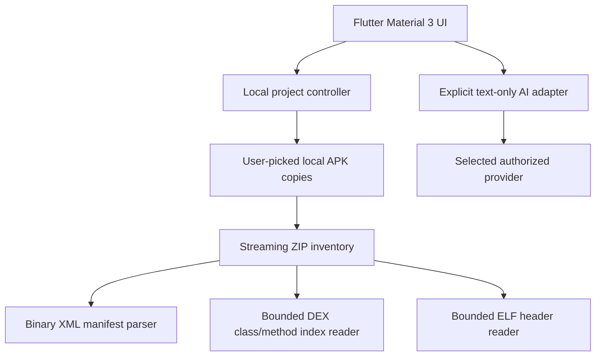

# Architecture

## MVP components

- `lib/main.dart`: Material 3 app and themes.
- `lib/screens/studio_screens.dart`: working project and inspector screens.
- `lib/services/studio_controller.dart`: import, project index and persistence.
- `lib/services/apk_analyzer.dart`: ZIP metadata, SHA-256, DEX/native inventory.
- `lib/services/android_manifest_parser.dart`: bounded Android binary XML parser.
- `lib/services/package_binary_reader.dart`: user-selected, bounded binary member extraction.
- `lib/services/dex_inspector.dart`: DEX 035–040 header/class/method name reader.
- `lib/services/elf_inspector.dart`: ELF32/ELF64 metadata reader.
- `lib/screens/binary_explorer_tabs.dart`: on-demand inspectors with class search.
- `lib/services/ai_chat_service.dart`: opt-in chat calls; no automatic binary context.
- `lib/services/google_account_service.dart`: OAuth account chooser when configured.

## Future engine split

- Flutter UI and task coordination remain in Dart.
- A Kotlin/Java plugin may later provide full Smali and native ELF disassembly.
- Heavy JADX/Apktool/Ghidra operations need Android compatibility validation or
  a separately approved external worker.
- Project source APKs remain local unless user explicitly authorizes export.

## Trust boundary

Imported files are untrusted. The MVP lists archive entries but does not
extract arbitrary paths or execute embedded bytecode. Manifest parsing has
size and count limits. AI keys remain only in memory during the session.
Never add automatic uploading of whole packages or credentials.
